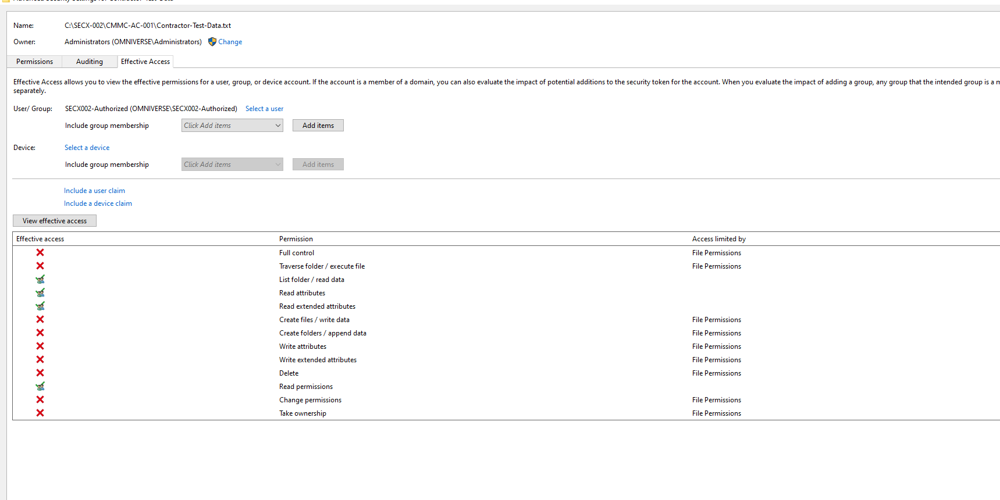
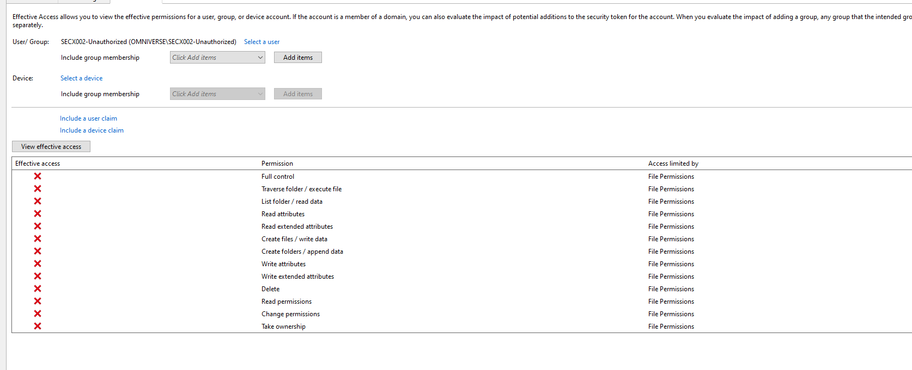
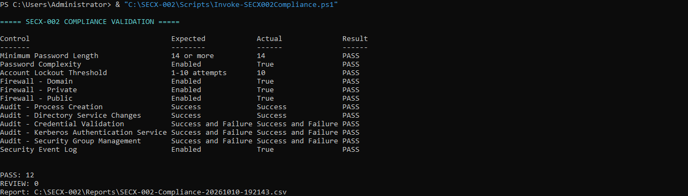

# SEC-009 - Enterprise GRC, NIST RMF & CMMC Readiness Assessment

> OmniVerse Enterprise Engineering Portfolio | Simulated defense-contractor assessment

Former project name: **SECX-002**. This case study is now **SEC-009**; historical VM paths, AD lab accounts, script/report names and source provenance retain their original names. See the [naming record](PROJECT-NAMING.md).

[Back to Portfolio](https://github.com/KSWISHA9) | [Executive Report](Reports/Executive-Security-Assessment.md) | [Control Matrix](Control-Mapping/Control-Assessment-Matrix.md) | [Evidence](Evidence/INDEX.md) | [Risk Register](Risk-Assessment/Risk-Register.csv)

## Executive Summary

Converted a hands-on identity and application lab into a simulated defense-contractor security assessment: inventory, business impact analysis, selected control mappings, system security plan, remediation milestones and an executive decision.

Technical evidence includes AD policy hardening, Windows audit configuration, controlled file-permission remediation and positive/negative Windows Effective Access evaluations. A standalone PowerShell run reports **12 PASS / 0 REVIEW** for a selected configuration baseline.

**This is a portfolio readiness assessment, not CMMC certification, an ATO or a production approval.** OmniVerse Defense Systems and Atlantic Defense Cloud Services are fictional; all contractor data is simulated and no real CUI is present.

## Assessment Snapshot

| Metric | Current scope |
| --- | --- |
| Inventoried assets | Three VirtualBox VMs plus the supporting Windows host |
| Scored risks / POA&M actions | Eight matched records; none closed |
| Selected framework rows | 20 SP 800-53 Rev. 5 references + 19 SP 800-171 Rev. 2/CMMC requirements |
| Local dispositions | 36 Partially Demonstrated; 3 Not Assessed; zero Met |
| Indexed screenshots | 24; no exact image duplicates |
| Automated baseline | 12 PASS / 0 REVIEW; script and actual CSV remain inside OV-DC01 |
| Configuration-drift exercise | Setting restored; exact byte-level recovery verification OPEN |
| Release status | Public simulated assessment; technical validation and artifact imports remain incomplete. [Release record](Reports/Release-Record.md) |

## Business Request

A fictional DoD subcontractor needs an evidence-based view of identity, application and operational security before considering sensitive workloads. The assessment connects technical observations to proposed business impacts, prioritized remediation and the evidence an assessor would still need.

## Problems Investigated and Addressed

### 1. Weak AD Password and Lockout Configuration

- **Problem:** Minimum password length was seven characters and the lockout threshold was zero (disabled).
- **Investigation:** Reviewed the default domain password policy and captured the baseline before remediation.
- **Solution:** Increased minimum length to 14 and the lockout threshold to 10; retained complexity and 30-minute lockout/observation settings.
- **Validation and outcome:** Get-ADDefaultDomainPasswordPolicy and net accounts /domain corroborated the settings, which persisted through one Group Policy refresh. [Remediation evidence](Reports/AD-Password-Policy-Remediation.md) supports configuration remediation; actual password rejection and lockout enforcement remain pending for R-006/R-007.

### 2. Incomplete Windows Security Audit Coverage

- **Problem:** Five selected audit subcategories lacked the intended success/failure coverage.
- **Investigation:** Reviewed advanced audit policy and the Security log, preserving the operator-reported baseline export before changes.
- **Solution:** Enabled Process Creation and Directory Service Changes success auditing, plus success/failure auditing for Credential Validation, Kerberos Authentication Service and Security Group Management.
- **Validation and outcome:** The settings persisted through one Group Policy refresh, and event 4688 was generated for whoami.exe. [Audit validation](Reports/Windows-Audit-Policy-Remediation.md) records this limited result; other events, SACL coverage, retention and centralized collection remain pending under R-008.

### 3. Excessive Access to Simulated Contractor Data

- **Problem:** A disabled test account was intentionally granted Full Control over a disposable training file; broad inherited Users access also required removal.
- **Investigation:** Inspected the NTFS ACL and compared its entries with the lab authorization policy. No exploitation was demonstrated.
- **Solution:** Removed excessive/broad permissions, disabled inheritance and assigned Read access to a dedicated AD readers group while retaining SYSTEM/Administrators Full Control.
- **Validation and outcome:** ACL checks found zero unexpected Allow entries and one authorized Reader entry. Windows Effective Access evaluated authorized read-only access and no permissions for the unauthorized identity. [Remediation and authorization evidence](Reports/CMMC-AC-001-Controlled-Access-Control-Exercise.md) is partial technical evidence: both accounts remained disabled and no actual login/file-read tests were performed.

Configuration remediation is not equivalent to full risk closure or CMMC compliance. The [configuration-drift exercise](Reports/CMMC-CM-001-Configuration-Drift-and-Recovery.md) restored the setting but **exact byte-level recovery remains OPEN**.

## Evidence Gallery

### 1. AD Password and Lockout Configuration

Minimum password length changed from 7 to 14; lockout threshold changed from 0 to 10. Complexity stayed enabled and the lockout duration/window stayed at 30 minutes. [Independent configuration validation](Reports/AD-Password-Policy-Remediation.md) does not replace password-rejection or lockout-enforcement tests.

### 2. Authorized Identity - Evaluated Read-Only Access

Read data, attributes and permissions are allowed; Write data, Delete and Full Control are not allowed. Reader-group membership and the account remaining disabled are operator-confirmed.

### 3. Unauthorized Identity - No Evaluated Permissions

No displayed file permissions are granted to the evaluated identity. Both accounts stayed disabled: these are **Windows Effective Access evaluations, not actual login or file-read attempts**. [Full finding/remediation record](Reports/CMMC-AC-001-Controlled-Access-Control-Exercise.md)

### 4. Standalone Configuration Baseline

Three AD settings, three firewall enabled flags, five audit settings and the Security log enabled flag passed the selected baseline. The corrected auditpol parser and standalone rerun are documented; the source script and actual CSV are pending host import. [Automation results and artifact status](Reports/Automation-Validation-and-Import.md)

[Browse the complete evidence index](Evidence/INDEX.md)

## Findings and Remediation Highlights

| Workstream | Documented result | Verification boundary |
| --- | --- | --- |
| AD password/lockout | Length 14, threshold 10, 30-minute timers; second command corroboration | R-006/R-007: configuration remediated, enforcement testing pending |
| [Windows auditing](Reports/Windows-Audit-Policy-Remediation.md) | Five subcategories hardened; whoami.exe event 4688 recorded | R-008: broader event/SACL/retention/collection validation pending |
| Policy refresh | Settings retained through one successful computer/user Group Policy refresh | Not reboot or repeated-refresh persistence |
| CMMC-AC-001 | Excessive Full Control removed; broad Users access removed; dedicated Read group and noninherited ACL | Effective Access evaluated; no actual interactive access attempts |
| CMMC-CM-001 | Simulated AuditLogging drift detected; Disabled restored to Enabled | Final SHA-256 differs from trusted baseline: exact byte-level recovery OPEN |
| [SOC-001](Reports/SOC-001-Entra-Connect-Service-Account-Authentication-Investigation.md) | Same-second ADSync account 4625/4624 investigated; service observed running | Root cause and synchronization health unconfirmed; no demonstrated attack |
| Vendor review | Five safeguards remain Unverified | Defer approval pending documentation; unknown is not noncompliance |

[CMMC-CM-001 drift record](Reports/CMMC-CM-001-Configuration-Drift-and-Recovery.md) is operator-reported; no corresponding screenshot, original file or hashes have been imported. It is tracked separately from the eight scored baseline risks, without inventing a ninth score or declaring recovery PASS.

## Assessment Methodology

1. Define the fictional mission, system boundary and dependencies.
2. Separate screenshot observations, operator-confirmed results, contextual prior work, assumptions and untested objectives.
3. Rate eight preliminary risks using proposed 1-5 likelihood x impact judgments.
4. Associate evidence with selected controls; evaluate the stated scope without awarding full compliance for narrow tests.
5. Propose owner roles, milestones and verification criteria; retain open gaps.
6. Present a simulated leadership recommendation through the RMF lifecycle.

SP 800-53 Rev. 5, SP 800-171 Rev. 2 and CMMC Level 2 identifiers are distinguished in the [framework overview](Control-Mapping/NIST-CMMC-Control-Assessment.md). Local Partially Demonstrated labels are not official CMMC findings. Requirements outside the selected assessment are not assessed, not implicitly satisfied.

## Business Impact and Risk Decisions

The [BIA](BIA/Business-Impact-Analysis.md) models AD/DNS and Keycloak RTO/RPO at 2h/1h, and the portal at 4h/2h. These are proposed targets, not demonstrated recovery capabilities.

A hypothetical AD-outage model uses $200,000 exposure, 25% loss factor and 0.4 annual occurrence: SLE $50,000 and ALE $20,000/year. A modeled $6,000 annual control cost and $5,000 residual ALE produce a $9,000 net annual benefit. These are illustrative inputs and arithmetic, not real financial data or proven effectiveness.

## Deliverables

| Document | Purpose |
| --- | --- |
| [Executive Assessment](Reports/Executive-Security-Assessment.md) | Decision summary, priorities and limitations |
| [Asset Inventory](Asset-Inventory.csv) | Three VMs and host dependency |
| [Risk Register](Risk-Assessment/Risk-Register.csv) | Eight proposed baseline ratings and treatments |
| [POA&M](POAM/Plan-of-Action-and-Milestones.csv) | Eight matched actions, proposed owners/dates and closure criteria |
| [BIA](BIA/Business-Impact-Analysis.md) | Dependencies, hypothetical losses and recovery targets |
| [RMF Lifecycle](RMF/RMF-Lifecycle.md) | Prepare through Monitor; hypothetical categorization and simulated authorization |
| [SSP](SSP/System-Security-Plan.md) | Boundary, flows, safeguards and gaps |
| [Control Matrix](Control-Mapping/Control-Assessment-Matrix.md) | Selected objectives, evidence, local statuses and recommendations |
| [Framework Overview](Control-Mapping/NIST-CMMC-Control-Assessment.md) | Distinct NIST/CMMC editions and interpretation limits |
| [Evidence Traceability](Control-Mapping/Evidence-Traceability.md) | Exact references, provenance and qualifications |
| [Vendor Assessment](Vendor-Assessment/Atlantic-Defense-Cloud-Services-Assessment.md) | Five unverified fictional supplier safeguards |
| [Methodology](Risk-Assessment/Methodology.md) | Scoring anchors and evidence conventions |
| [Recovery Verification Plan](POAM/Recovery-Validation-Plan.md) | Proposed restoration tests |
| [Assumptions and Missing Information](Reports/Assumptions-and-Missing-Information.md) | Unverified facts and missing artifacts |
| [Finalization and Readiness](Reports/Finalization-v1.0.md) | Package status, release gates and addenda |
| [Scripts Import Status](Scripts/README.md) | VM-only source/report destinations, not dummy files |

## What This Demonstrates

- Translating technical identity/security evidence into governance and risk decisions.
- Maintaining an SSP, BIA, risk register and POA&M with traceable limitations.
- AD security configuration remediation and Windows audit verification.
- Group-based NTFS least privilege and evaluated positive/negative authorization.
- PowerShell baseline checks without equating PASS with compliance.
- Investigation, drift analysis and honest remediation acceptance criteria.

## Open Work and Publication

OIDC cutover, DNS, CA-key separation, NAT-side SSH and Keycloak database findings remain open. AD enforcement, broader audit coverage, current-stack restoration, byte-identical configuration recovery and vendor assurance remain incomplete.

The eight risk scores, owner roles and dates are proposed; current residual ratings are unassessed. Current automation artifacts remain VM-only. Cross-project references link to the separate SEC-008 repository. No certification, real CUI, complete 110-requirement assessment or full Zero Trust deployment is claimed.

Hands-on work is paused until Monday, October 12, 2026. Evaluate-STIG/STIG Viewer, Wazuh, authorized Nessus/Qualys assessments and applicable Linux assessment tooling are next-phase candidates, **not installed or credited by this publication**. Publication does not close any technical finding.

## Related Portfolio Work

- [SEC-001 - Enterprise SOC Engineering](https://github.com/KSWISHA9/SEC-001-Enterprise-SOC-Engineering)
- [SEC-002 - Enterprise Vulnerability Management](https://github.com/KSWISHA9/SEC-002-Enterprise-Vulnerability-Management)
- [IAM-006 - Identity Operations & Risk Analytics](https://github.com/KSWISHA9/IAM-006-Enterprise-Identity-Operations-Risk-Analytics)

Created by **Keshawn Lynch**.
