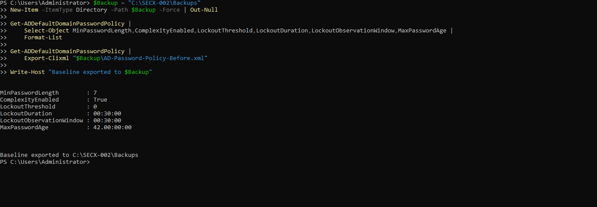
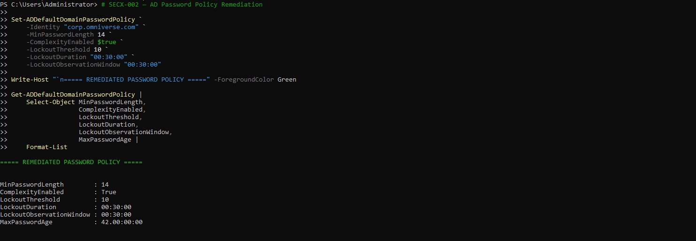
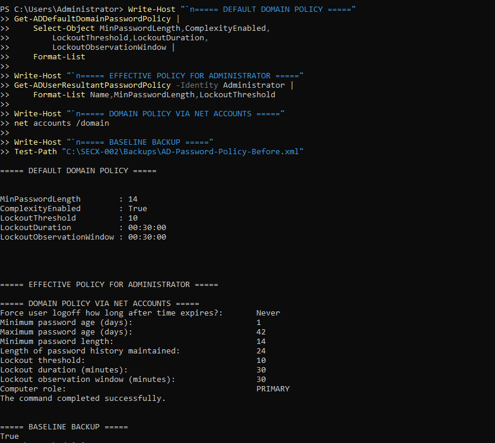

# AD Password Policy Remediation and Verification

Update date: 2026-10-10. System: OV-DC01, corp.omniverse.com. The operator performed remediation; the repository maintainer inspected screenshots and updated assessment artifacts only. No VM commands were executed by the maintainer.

## Before and After

| Setting | Before: REM-01 | After: REM-02/03 |
| --- | --- | --- |
| Minimum password length | 7 | 14 |
| Complexity | Enabled | Enabled |
| Lockout threshold | 0 (disabled) | 10 |
| Lockout duration | 30 minutes | 30 minutes |
| Observation window | 30 minutes | 30 minutes |
| Maximum password age | 42 days | 42 days |

REM-03 also shows minimum age 1 day and password history 24 through `net accounts /domain`; no change to these settings is claimed.

### Baseline and Preservation

The captured export command and message refer to `C:\SECX-002\Backups\AD-Password-Policy-Before.xml` on OV-DC01. REM-03 shows `Test-Path` True for that path. The file is operator-confirmed and existence-corroborated on the VM; it is not available at that path on the maintainer host and was not copied, opened, hashed or restored. It is a policy configuration export, not proof of a system-state backup.

### Updated Configuration

The capture shows `Set-ADDefaultDomainPasswordPolicy` followed by `Get-ADDefaultDomainPasswordPolicy` with the new values. This verifies reported runtime configuration, not rejection of weak passwords or account lockout behavior.

### Cross-Command Validation

`net accounts /domain` separately reports length 14, threshold 10 and both timers 30 minutes. It corroborates configuration on the same domain, not an independent authentication test. `Get-ADUserResultantPasswordPolicy -Identity Administrator` produces no displayed policy object, consistent with the operator's no-fine-grained-policy result for that identity. Do not extrapolate to all accounts. This cmdlet examines resultant fine-grained policy, not interactive enforcement; see [Microsoft cmdlet documentation](https://learn.microsoft.com/en-us/powershell/module/activedirectory/get-aduserresultantpasswordpolicy?view=windowsserver2025-ps).

## Risk and POA&M Status

R-006 and R-007: **Configuration remediated, enforcement testing pending.** P-006 and P-007 carry the same status. Initial proposed scores 16/High and 20/Critical are retained as historical baseline estimates, not current residual ratings. No risk is closed, no acceptance was granted and no measured risk reduction is asserted.

The earlier POA&M's candidate 15-minute lockout timers were planning assumptions. Actual captured implementation uses 30 minutes; all current verification criteria use 30 minutes. Proposed due dates now apply to the remaining validation, not to a still-unperformed configuration change.

## Remaining Closure Evidence

- With operator approval, use dedicated nonprivileged test accounts, not Administrator, and preserve emergency access.
- Verify per-user default/fine-grained policy applicability for representative users and any service-account constraints.
- Test rejection of too-short password changes and acceptance of compliant candidates without recording values. Complexity remains enabled; do not infer full character-change/history compliance from its flag alone.
- Verify controlled unsuccessful-logon limiting at the configured threshold, counting/reset behavior, lockout duration and safe recovery/unlock. Record events/results without credentials; consider DoS impact.
- Verify administrative-account protections separately. Built-in Administrator behavior must not be inferred from a default-domain policy query; [Microsoft documents special lockout behavior](https://learn.microsoft.com/windows/security/threat-protection/security-policy-settings/account-lockout-threshold).
- Obtain compatibility review and risk-owner approval, then reassess residual risk.

Existing passwords are not proven to be 14 characters merely because the configured minimum changed. No password attempts, lockout attempts or restoration were executed by the maintainer. Evidence is visually reviewed with no visible secret values observed; originals remain preserved.
